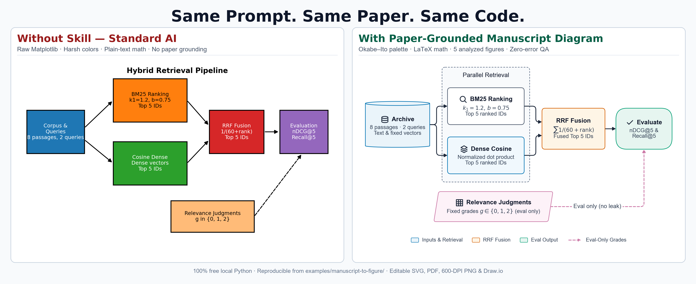
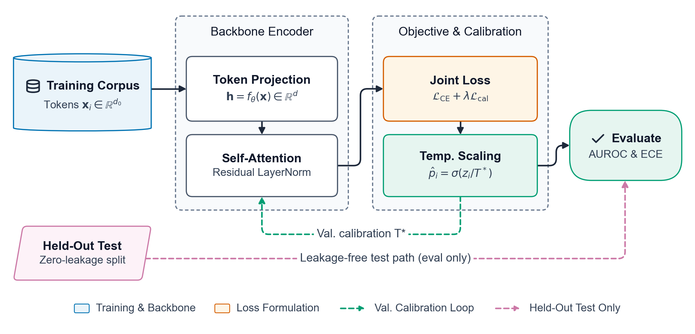
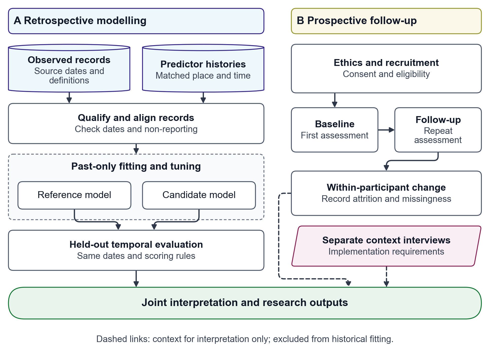
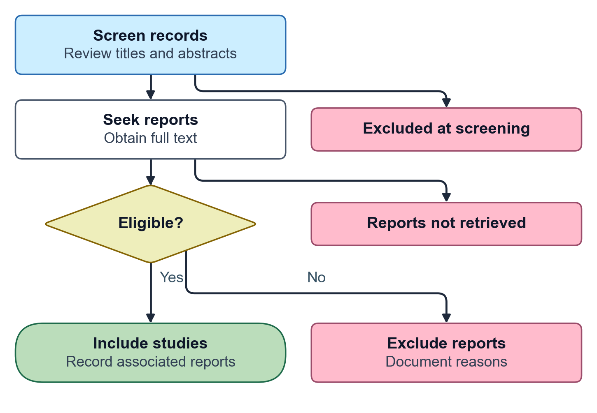

<div align="center">

<h1>Paper-Grounded Manuscript Diagram</h1>

<p><strong>Stop fighting PowerPoint for 6 hours—and stop submitting AI-slop flowcharts to peer review.</strong><br>
Turn any methods section or codebase into a <strong>publication-ready, vector-exact scientific figure</strong> grounded in real peer-reviewed literature—from a single prompt.</p>

<p>
  <a href="https://github.com/asifahamed11/paper-grounded-manuscript-diagram/actions/workflows/validate.yml"></a>
  
  
  
  
  <a href="LICENSE"></a>
</p>

<p>
  <a href="#before-vs-after">Before vs. After</a> &middot;
  <a href="#showcase-gallery">Gallery</a> &middot;
  <a href="#how-it-works">How It Works</a> &middot;
  <a href="#quickstart">Quickstart</a> &middot;
  <a href="#built-for-real-publishing-standards">Palettes &amp; Profiles</a> &middot;
  <a href="#every-format-reviewers--co-authors-ask-for">Exports</a>
</p>

</div>

---

<h2 id="before-vs-after">Before vs. After: Same Prompt, Same Paper, Same Code</h2>

An AI agent received the exact same [prompt brief](assets/readme/comparison-prompt.txt), [methods draft](examples/manuscript-to-figure/manuscript.md), and [runnable Python implementation](examples/manuscript-to-figure/retrieval.py). Left: raw one-shot Matplotlib generation. Right: full **Paper-Grounded Manuscript Diagram** output inspected against **five peer-reviewed retrieval architectures** and verified with automated geometry, contrast, and source checks.

<p align="center">
  <a href="assets/readme/hero-comparison.png">
    
  </a>
</p>

<p align="center">
  <em>Inspect the inputs:</em>
  <a href="assets/readme/comparison-prompt.txt">Prompt</a> &middot;
  <a href="examples/manuscript-to-figure/manuscript.md">Manuscript</a> &middot;
  <a href="examples/manuscript-to-figure/retrieval.py">Code</a> &middot;
  <a href="examples/manuscript-to-figure/figure-review.md">5-Paper Figure Review</a>
</p>

---

<h2>Why Researchers Never Go Back</h2>

| Feature | Standard AI / LLM | Manual (Illustrator / BioRender) | Paper-Grounded Manuscript Diagram |
|---|---|---|---|
| **Literature grounding** | Guesses generic box layouts blindly | Hours of manual PDF hunting | Auto-fetches OA PDFs via OpenAlex &amp; arXiv and deeply analyzes **&ge; 5 matching published diagrams** |
| **Visual quality** | AI-slop SaaS cards &amp; crooked arrows | Hours of manual snapping &amp; alignment | Flat Illustrator / TikZ-grade geometry, rounded corridors &amp; measured grids |
| **Scientific fidelity** | Hallucinates layers, splits, or connections | Error-prone manual transcription | Every substantive node and edge linked to manuscript &amp; code via `--require-sources` |
| **Typography &amp; Math** | Broken `$` glyphs &amp; clipped box labels | Manual equation screenshots &amp; pastes | Crisp sans-serif LaTeX mathtext (`\mathbf{h} \in \mathbb{R}^d`) with math-aware wrapping |
| **Accessibility &amp; Print QA** | Clashing neon fills &amp; tiny unread fonts | Manual eye-balling &amp; journal rejections | **Okabe–Ito** &amp; **Paul Tol** palettes + automated WCAG contrast, overlap &amp; print-scale QA |
| **Cost &amp; Privacy** | Paid API credits; uploads drafts to cloud | Expensive annual SaaS subscriptions | **100% free local Python** — unpublished manuscripts never leave your machine |
| **Deliverables** | Uneditable flat raster PNG | Proprietary tool lock-in | Editable **SVG**, Outlined **SVG**, Vector **PDF**, **600-DPI PNG**, **1:1 Print PNG**, **Draw.io**, **EPS**, **TIFF** |

---

<h2 id="how-it-works">From a method to an editable figure</h2>

Open your manuscript, code, or outline in your workspace and ask your agent:

```text
Use $paper-grounded-manuscript-diagram to explain my model architecture.
Show how the inputs, feature scales, and output connect at the target print width.
```

The agent sets the reader question, diagram type, detail level, and physical
width. The [planning guide](references/figure-planning.md) helps it choose an
overview, a detailed view, or linked panels. It can find public paper
candidates with `fetch_papers.py` and review actual full pages and captions
before adapting a design convention. Use
[`design_review`](references/method-to-figure.md#trace-content-and-design-choices)
to record where each studied relationship and adopted convention appears.

The Python tools rank metadata, prepare review pages, plan routes, render, and
check export geometry. An author or agent inspects the publications and the
figure at print size and checks the scientific claims against the study.

---

<h2 id="showcase-gallery">Publication Showcase Gallery</h2>

Every figure below was rendered directly from editable JSON specifications in [`templates/`](templates/) using our local engine (`render_diagram.py` / `plan_diagram.py`) and verified with `validate_svg.py`:

<p align="center">
  <a href="assets/readme/showcase-architecture.png">
    
  </a><br>
  <strong>ML / AI Architecture &middot; <code>okabe-ito</code> &middot; IEEE Double-Column (<code>515 pt</code>)</strong> — Shaded dashed containers, sans-serif LaTeX math, leakage-free held-out test route, and validation loop (<a href="templates/ml-architecture.json">source JSON</a>).
</p>

<table>
  <tr>
    <td width="53%" valign="top" align="center">
      <a href="assets/readme/showcase-framework.png">
        
      </a><br>
      <strong>Parallel Research Framework &middot; <code>paul-tol-muted</code></strong><br>
      Coordinated retrospective &amp; prospective tracks with dashed context boundaries (<a href="templates/parallel-study.json">source JSON</a>).
    </td>
    <td width="47%" valign="top" align="center">
      <a href="assets/readme/showcase-prisma.png">
        
      </a><br>
      <strong>PRISMA &amp; Screening Flowchart &middot; <code>paul-tol-pale</code></strong><br>
      Auto-planned layered lanes, decision diamonds, and exclusion exits (<a href="templates/review-selection-method.json">source JSON</a>).
    </td>
  </tr>
</table>

---

<h2 id="built-for-real-publishing-standards">Built for Real Publishing Standards</h2>

<table>
  <tr>
    <td width="50%" valign="top">
      <h3>Colorblind-Safe Scientific Palettes</h3>
      <ul>
        <li><code>okabe-ito</code> — General scientific default (ML/AI pipelines, experimental workflows, labelled comparisons)</li>
        <li><code>paul-tol-muted</code> — Research frameworks, conceptual models &amp; multi-category architectures</li>
        <li><code>paul-tol-pale</code> — Text-heavy PRISMA screening &amp; clinical decision flowcharts</li>
        <li><code>print-mono</code> — High-contrast black &amp; white print proceedings</li>
      </ul>
    </td>
    <td width="50%" valign="top">
      <h3>Journal-Calibrated Export Profiles</h3>
      <ul>
        <li><strong>IEEE:</strong> <code>ieee-single</code> (88 mm) &amp; <code>ieee-double</code> (181 mm)</li>
        <li><strong>Nature / Springer / Elsevier:</strong> <code>nature-single</code> (89 mm), <code>nature-double</code> (183 mm), <code>springer-lncs</code> (122 mm), <code>elsevier-double</code> (190 mm)</li>
        <li><strong>PLOS ONE:</strong> <code>plos-one</code> (66.8–190.5 mm, 300–600 DPI, LZW TIFF &lt; 10 MB)</li>
      </ul>
    </td>
  </tr>
  <tr>
    <td width="50%" valign="top">
      <h3>3-Tier Vector &amp; Cutout Icon System</h3>
      <ul>
        <li><strong>30 Built-in Pure-Vector Icons:</strong> Data, AI/compute &amp; lab symbols listed via <code>--list-icons</code></li>
        <li><strong>Custom Local SVGs:</strong> Pure-vector paths embedded cleanly across SVG, PDF, EPS &amp; Draw.io</li>
        <li><strong>Transparent Cutouts:</strong> Deterministic matte cleanup via <code>scripts/prepare_icon.py</code></li>
      </ul>
    </td>
    <td width="50%" valign="top">
      <h3 id="every-format-reviewers--co-authors-ask-for">Every Format Reviewers &amp; Co-Authors Ask For</h3>
      <ul>
        <li>Editable <code>.svg</code> &amp; font-independent Outlined <code>.svg</code></li>
        <li>Vector <code>.pdf</code> &amp; <code>.eps</code> + 600-DPI &amp; <code>1:1</code> Print-Size <code>.png</code></li>
        <li>Native <strong>Draw.io</strong> (<code>.drawio</code>) with container groups &amp; connectors</li>
        <li>Lossless RGB LZW <code>.tiff</code>, portable <code>-source.json</code> &amp; auditable <code>-qa.json</code></li>
      </ul>
    </td>
  </tr>
</table>

---

<h2 id="quickstart">30-Second Quickstart</h2>

### 1. With Your AI Coding Agent (Claude Code, Codex, Cursor, Antigravity, Gemini CLI)

Clone or copy `paper-grounded-manuscript-diagram` into your agent's skill directory (see [platform setup guide](references/platform-compatibility.md)) and ask:

```text
Use $paper-grounded-manuscript-diagram to draw my method from methods.md.
Ground it in at least 5 peer-reviewed published diagrams of the same type,
apply a colorblind-safe palette, and inspect the 1:1 print-size PNG.
```

### 2. Try Locally in Python (3 Commands)

Rendering uses Python 3.10+, Matplotlib and Pillow. PDF review uses optional PyMuPDF.

```sh
python -m pip install -r requirements-render.txt
python scripts/plan_diagram.py --doctor
python scripts/plan_diagram.py templates/review-selection-method.json --output-dir demo --drawio --require-sources
```

Inspect `demo/method-print-size.png`, `demo/method.svg`, and `demo/method.drawio`
with the provenance receipt `demo/method-qa.json`. For a reproducible
[architecture overview and detail](templates/multiscale-architecture.json),
render the synthetic four-scale example:

```sh
python scripts/render_diagram.py templates/multiscale-architecture.json --output-dir demo --stem multiscale --drawio --require-sources --require-paper-figures --require-shape-review
```

The [shape guide](references/scientific-shapes.md) explains how to inventory the
shapes in each inspected paper figure, then map the conventions to study-backed
nodes. It includes a [second example](templates/scientific-shapes.json) covering
all seven additional shapes in a comparison pipeline and system handoff.

---

## Privacy, Scientific Integrity & Documentation

- **Local-First Privacy:** Unpublished manuscripts, codebases, and extracted PDF figures stay strictly on your local machine — never uploaded to third-party diagram SaaS platforms or external image models.
- **Evidence checks** `--require-sources` requires method, code or dataset
  references for substantive nodes and edges. `--require-design-review` checks
  the mappings from reader questions and figure precedents to elements.
  Combined with `--require-paper-figures`, it counts distinct papers with
  recorded inspection and publication status. DOI/URL normalization and these
  structural checks run offline. Confirm actual access, publication, and
  scientific support during review.

<p align="center">
  <a href="SKILL.md">Skill Instructions</a> &middot;
  <a href="references/paper-research-protocol.md">Research Protocol</a> &middot;
  <a href="references/design-system.md">Design System</a> &middot;
  <a href="references/rendering.md">Rendering Contract</a> &middot;
  <a href="references/method-to-figure.md">Method-to-Figure Guide</a> &middot;
  <a href="CONTRIBUTING.md">Contributing</a> &middot;
  <a href="LICENSE">MIT License</a>
</p>
