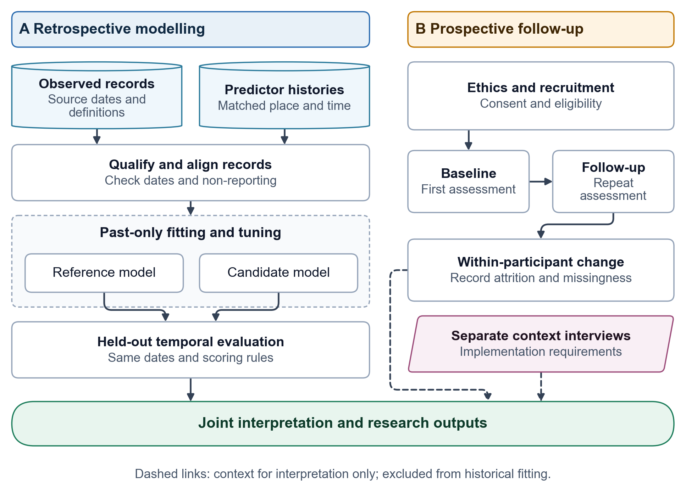
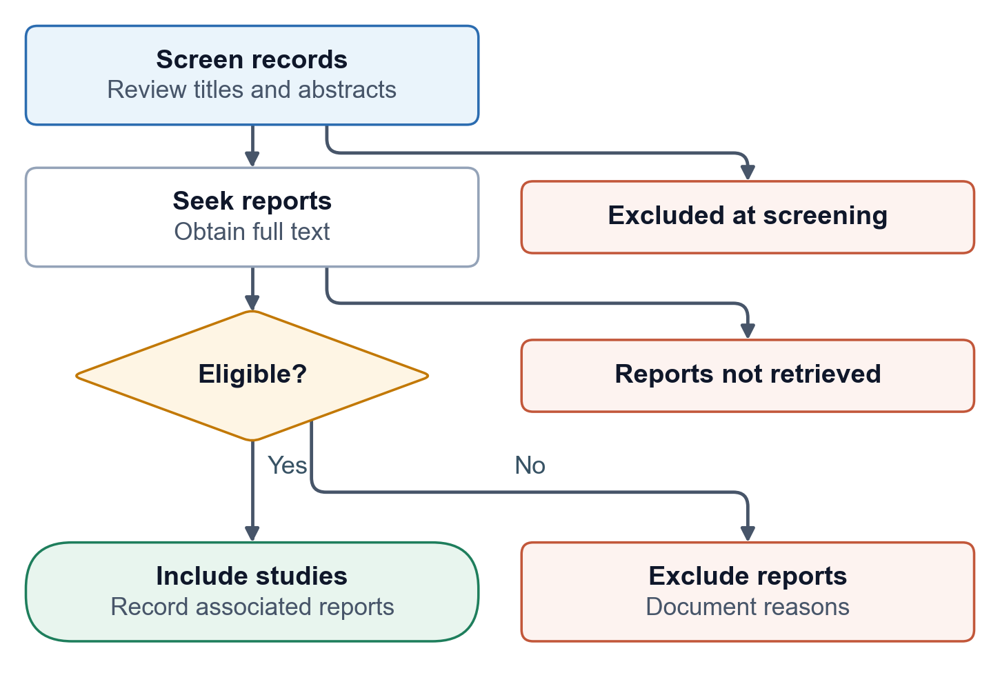
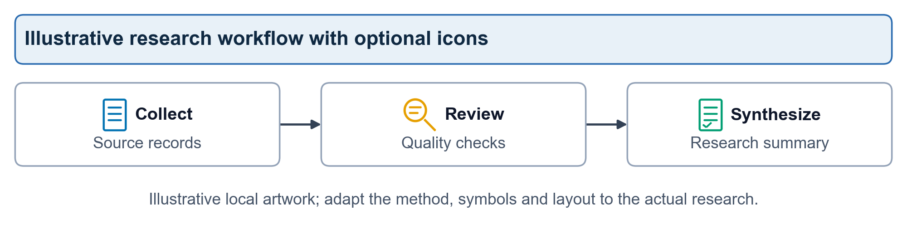

# Paper-Grounded Manuscript Diagram

Create editable manuscript diagrams from a research method. Start with the stages and relationships, choose the intended print width, and review a measured layout before export.

This local workflow runs with Python and free libraries. The final files include SVG, PDF, PNG and a reproducible specification. Native draw.io and TIFF are available as options.



*An illustrative [parallel-study example](templates/parallel-study.json), rendered with the bundled local engine. This is a layout demonstration, not a research result.*

## Same prompt, two agent runs

An agent wrote a small hybrid retrieval experiment and its methods draft. Two runs used the same files and figure brief.

[](assets/readme/same-prompt-comparison.png)

The baseline drew from the manuscript and code. The skill run also inspected figures from three published papers, drew five original icons and checked each step and arrow against the implementation. Open the image for the full-size comparison.

[Shared prompt](assets/readme/comparison-prompt.txt) · [Manuscript](examples/manuscript-to-figure/manuscript.md) · [Runnable code](examples/manuscript-to-figure/retrieval.py) · [Figure review](examples/manuscript-to-figure/figure-review.md)

## Why use it?

- Start from stages and relationships or bring an existing layout, with support for skip-rank DAGs, feedback loops, and horizontal pipelines.
- Apply 5 curated publication themes (`nature-clean`, `ieee-crisp`, `neurips-soft`, `biomed-prisma`, `print-mono`) and 7 journal-calibrated profiles (`ieee-single/double`, `nature-single/double`, etc.).
- Enhance diagrams with a 3-tier icon system: host AI image cutouts, custom local `.svg` vector icons, and 30 built-in instant vector symbols.
- Render crisp inline LaTeX math expressions (`\( ... \)` and opt-in `$...$`) with math-aware text wrapping.
- Query and filter open-access literature via free Python stdlib paper fetching (OpenAlex & arXiv) with zero API keys.
- Link substantive stages and arrows to manuscript sections or other source locations via `--require-sources`.
- Check text size, WCAG contrast, ports, crossings and spacing at the intended print width.
- Export to editable SVG, vector PDF, 600-DPI PNG, print-size PNG, native Draw.io, EPS, or lossless TIFF.

## Get started

Copy the `paper-grounded-manuscript-diagram` folder into your agent's skill directory and ask it to use the skill with your method. See the [platform setup guide](references/platform-compatibility.md).

```text
Use $paper-grounded-manuscript-diagram to draw my method.
Preserve its scientific meaning. Choose a compact, clean layout with rounded
shapes and connectors. Review relevant paper figures where useful.
Deliver SVG, PDF, 600-DPI PNG and source; inspect the actual print-size output.
```

Try the example locally in a Python environment. Install the optional libraries once if they are missing.

```sh
python -m pip install -r requirements-render.txt
python scripts/plan_diagram.py --doctor
python scripts/plan_diagram.py templates/review-selection-method.json --output-dir demo --drawio --require-sources
```

Open `demo/method-print-size.png` and `demo/method.drawio`. The example builds a screening workflow excerpt from a [public source](https://www.bmj.com/content/372/bmj.n71), and the QA receipt links nodes and arrows to specific source locations. [Input and figure walkthrough](references/method-to-figure.md).



## Icons that fit the content

Use an icon when it clarifies the stage. The planner compares title, side and top placement using the amount of wrapping and space each needs. The example uses locally drawn symbols.



See the [icon example and source](templates/icon-workflow/diagram.json).

## Go deeper

[Skill instructions](SKILL.md) · [Method and source fields](references/method-to-figure.md) · [Drawing contract](references/rendering.md) · [Icon workflow](references/icon-workflow.md)

Keep unpublished materials local, use legally accessible sources and record the figures actually inspected. Automated checks support review; they do not certify scientific validity or journal acceptance.

## Contribute

Useful examples, layout bug reports, clearer conventions and focused fixes are welcome. Share a small public or synthetic case and before/after images. See [the contribution guide](CONTRIBUTING.md).

[MIT licence](LICENSE)
